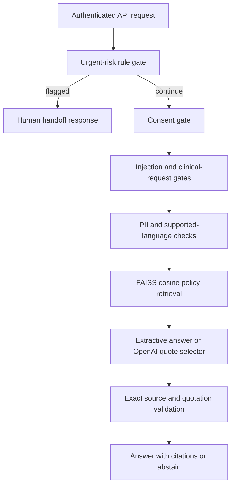

# Healthcare LLM Guardrails

**A source-grounded administrative onboarding API with explicit consent, policy
gates, human handoff and constrained LLM integration.**


Clinical onboarding conversations mix administrative requests with sensitive and
medical questions. This project separates those paths before invoking a model,
retrieves an approved fictional policy, and accepts only quotations that can be
matched to retrieved evidence. It demonstrates software architecture for guardrails;
it is not a clinical decision system or a medical safety certification.

## Architecture



The rule gate is English-only and heuristic. It can over-trigger on negated risk
phrases and miss obfuscated language. PII patterns are not comprehensive. Detected
personal information is routed away from the provider; this does not establish
that undetected sensitive content cannot pass. No raw conversation is persisted.

Conversation states are `start`, `consented`, and `ready`; clients may submit state
for UI continuity, but it never grants authorization or bypasses the consent check.
This stateless API does not persist patient consent records or a clinical history.

## API

| Method | Endpoint | Behavior |
|---|---|---|
| POST | `/v1/onboarding` | Guarded administrative turn; authenticated |
| GET | `/metrics` | Authenticated aggregate route counters |
| GET | `/healthz` | Process health |
| GET | `/readyz` | Policy initialization readiness |
| GET | `/openapi.json` | Machine-readable API schema |

Example request, with `X-API-Key` from the generated local `.env`:

```json
{"message":"How does appointment booking work?","consent":true,"state":"start","provider":"extractive"}
```

Example response:

```json
{
  "route":"answered",
  "state":"ready",
  "message":"Here is the administrative policy information.",
  "claims":[{"source":"booking-v1","quote":"Appointment booking is available through the secure patient portal. The service team confirms appointment times."}],
  "disclaimer":"Administrative demo only. A qualified clinician must assess medical concerns."
}
```

Possible routes: `urgent_handoff`, `consent_required`, `blocked`, `clinical_handoff`,
`privacy_handoff`, `answered`, `abstained`. Requests exceeding 1 MiB return 413;
invalid schemas return 422 without echoing the input; invalid keys return 401;
authenticated tenants are limited to 120 requests/minute per process (429).
The [checked-in OpenAPI schema](docs/openapi.json) documents complete fields.

## Measured results

Executed on 28 October 2026, Python 3.12.14, Windows CPU:

| Check | Observed result |
|---|---:|
| Unit/API/protocol tests | 40 passed |
| Line coverage | 95.76% |
| Synthetic route decisions | 30/30 |
| Mean in-process decision latency | 0.175 ms |
| p95 in-process decision latency | 0.483 ms |

The 30 manually authored development cases overlap unit-test scenarios. An initial
27/30 run exposed two missed urgent phrases and an obfuscated email; rules were
updated and regression-tested, producing the current 30/30 result. **This is tuned
development-set performance, not held-out clinical accuracy, real-time network
latency, LLM quality, or evidence of general safety.** All results use the offline
path. The raw [evaluation](artifacts/evaluation.json) contains every case outcome
and a dataset/code hash. Exact-source quotations establish attribution only.


## Run locally

Python 3.12, CPU only. No paid API or model download is required for the default path.

```bash
python -m venv .venv
# Windows: .venv\Scripts\activate
# macOS/Linux: source .venv/bin/activate
python -m pip install -r requirements-dev.txt
python scripts/start.py
```

The server starts at `http://127.0.0.1:8000`; interactive API documentation is at
`/docs`. The startup helper generates a local API key in the ignored `.env` file.
Supply it as `X-API-Key` when using Swagger's request fields or an HTTP client.

For an immediate self-contained API demonstration without starting a server:

```bash
python scripts/demo.py
```

## Tests, evaluation and containers

```bash
python -m pytest --cov=app --cov-report=term-missing
python -m ruff check .
python scripts/evaluate.py
python scripts/start.py --init-only
docker compose up --build
```

Compose binds only localhost, runs as a non-root user, drops Linux capabilities,
and uses a read-only root filesystem with a dedicated data volume. Container build
and readiness checks passed in GitHub Actions, along with Windows/Linux tests
and the dependency audit. [Executed validation](docs/VALIDATION.md) separates completed checks
from untested integrations.

## Optional OpenAI integration

Set `OPENAI_API_KEY` and an explicit compatible `OPENAI_MODEL` in the local `.env`,
then select `"provider":"openai"` in the API request. The adapter uses the
[Responses API with Structured Outputs](https://developers.openai.com/api/docs/guides/structured-outputs?api-mode=responses),
`store:false`, bounded output and exact-source validation. Refusals, incomplete
responses, malformed JSON, timeouts and unsupported quotations result in abstention.
There are no autonomous tools or arbitrary provider URLs. No live OpenAI result is
claimed by the test suite. External data transfer requires the deployment's own
privacy controls; `store:false` is not a zero-retention guarantee.

## Project layout

```text
app/          API, retrieval, provider and security implementation
data/         Synthetic policies or sample documents
tests/        API, isolation, failure and protocol checks
scripts/      Local startup, demonstration and evaluation
docs/         OpenAPI, validation and operating boundaries
artifacts/    Executed test, coverage and evaluation reports
.github/      CI workflow
```

## Scope and provenance

Created with AI assistance as an independently implemented portfolio project.
Professional experience inspired the problem; no employer code, patient records,
private documents or employer evaluation datasets are included. CV metrics belong
to the author's reported professional experience and are not results of this repository.
Default vectorization uses a deterministic 384-dimensional word-hash baseline;
it has collisions and does not understand synonyms. The optional
[SentenceTransformer adapter](https://sbert.net/docs/package_reference/sentence_transformer/model.html)
loads approved local models only and has not been validated in this delivery.

See [security boundaries](SECURITY.md), [operations](docs/OPERATIONS.md), and the
[MIT license](LICENSE).
